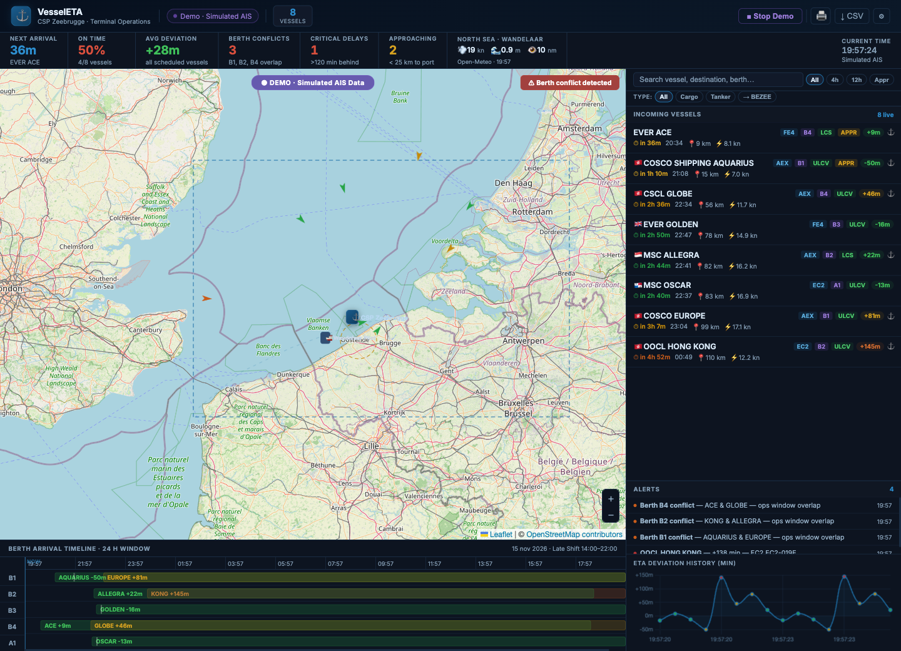
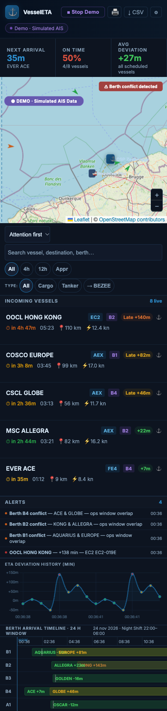

# VesselETA — CSP Zeebrugge

[](https://github.com/phlppgdfry/vessel-eta-tracker/actions/workflows/portfolio-pages.yml)

## Interactive portfolio

**[Open the demo](https://phlppgdfry.github.io/vessel-eta-tracker/)** · [Two-minute walkthrough](docs/PORTFOLIO.md) · [Verification notes](docs/VERIFICATION.md)

No credentials required. The public demo uses synthetic sample data; it is an
independent portfolio project, not an operating terminal or ERP environment.



<details><summary>Mobile preview</summary>



</details>

---

> Real-time vessel tracking dashboard for container terminal operations. Compares live AIS positions against the planned N4 arrival schedule and alerts planners when ships deviate from their ETA — before they arrive.

**[▶ Live Demo](https://phlppgdfry.github.io/vessel-eta-tracker/)** — no API key needed, demo launches automatically.

---

## The problem

Disrupted sailing schedules are one of the biggest operational challenges for container terminals. When a vessel arrives 6 hours late:

- The **yard plan is wrong** — containers are pre-positioned for a ship that isn't coming
- **Crane crews are misallocated** — expensive idle time or unplanned overtime
- **Truck appointments don't match** — gate congestion, missed slots
- **Vessel stack cutoffs** are missed — cargo rolled to next departure

Early ETA visibility gives operations the time to adapt. This tool surfaces deviations **while the vessel is still at sea**.

---

## Features

| Feature | Description |
|---|---|
| **Demo mode** | Auto-starts with 8 simulated vessels — no API key required |
| **Live AIS feed** | Real vessel positions via aisstream.io WebSocket |
| **KPI dashboard** | Vessels tracked · On-time % · Average deviation · Critical alerts |
| **Directional markers** | Triangle icons rotate to show vessel heading (COG) |
| **ETA deviation** | Calculated ETA vs N4 scheduled ETA, colour-coded by severity |
| **Alert log** | Critical deviations (>120 min) trigger toast + alert log |
| **Vessel detail** | Voyage, service line, scheduled vs calculated ETA, approach line on map |
| **Search & filter** | Search vessels and destinations; sort by delay priority or arrival time |
| **ETA chart** | Deviation history for the last 30 updates |
| **CSV export** | One-click export of current vessel state |

---

## How it works

```
Live AIS feed (aisstream.io WebSocket)
        │
        ▼
Filter vessels in bounding box  ←  North Sea / English Channel approach
        │
        ▼
Position + speed  →  estimate arrival from straight-line distance
        │
        ▼
Compare against N4 planned schedule
        │
        ▼
Deviation > threshold?  →  Alert (toast + log)
```

---

## Quick start

### Option 1 — Demo (no setup)

1. Open the hosted demo, or run `npm ci && npm start` and visit `http://localhost:3000`
2. Demo launches automatically with 8 simulated vessels

Or use the [hosted version](https://phlppgdfry.github.io/vessel-eta-tracker/).

### Option 2 — Live AIS data

1. Obtain your own AISStream key from [aisstream.io](https://aisstream.io).
2. Run `npm ci` and `npm start` (Node 22+); open `http://localhost:3000`.
3. Open Settings, enter the key, and connect through the local `/ais` WebSocket proxy.
4. Positions appear when vessels broadcast inside the monitored area. The key stays in the current browser session; never commit it.

The GitHub Pages version is an automatic simulation. It cannot host the Node proxy.
No production N4 schedule is connected. The browser libraries are copied from
locked npm dependencies during `npm run build`; map tiles still use OpenStreetMap
and optional weather uses Open-Meteo. A failed weather request does not stop the demo.

---

## ETA deviation colour coding

| Colour | Meaning | Threshold |
|---|---|---|
| 🟢 Green | On schedule or early | < +30 min |
| 🟡 Yellow | Moderate delay | +30 – +120 min |
| 🟠 Orange | Significant delay | +120 – +240 min |
| 🔴 Red | Critical — action required | > +240 min |

---

## Tech stack

| Layer | Technology |
|---|---|
| Frontend | HTML / CSS / JavaScript; npm build vendors browser libraries |
| Map | [Leaflet.js](https://leafletjs.com) + OpenStreetMap tiles |
| Charts | [Chart.js](https://chartjs.org) |
| AIS data | [aisstream.io](https://aisstream.io) — free WebSocket API |
| Schedule | Simulated N4 data (production: replace with N4 REST API) |

No frontend framework. A small Node/`ws` server provides the optional local AIS proxy; GitHub Pages serves the built simulation.

---

## Production integration points

To go from demo to production, replace:

```javascript
// In index.html — the N4 schedule array
const N4 = [
  { mmsi: '477307900', name: 'COSCO SHIPPING AQUARIUS', eta: oh(-0.5), svc: 'AEX', voy: 'AEX-041W' },
  // ...
];
```

With a fetch from your N4 REST API:

```javascript
const N4 = await fetch('/api/n4/expected-arrivals').then(r => r.json());
```

A production connection also needs authenticated schedule access, schema validation, timezone handling, secure proxy deployment and operational acceptance testing. ETA here is a straight-line distance/speed estimate; it does not model nautical routes, tides, pilotage or berth availability.

---

## Why Zeebrugge

CSP Zeebrugge handles vessels on the AEX, EC2, and FE4 service loops — connecting the UK, Ireland, Scandinavia and the Baltics through the English Channel and southern North Sea. In disrupted alliance seasons, vessels can run 6–24 hours off schedule. For a terminal processing 1M+ TEU per year, early visibility of those deviations directly reduces rehandles, overtime, and crane idle time.

---

## License

MIT — see [LICENSE](LICENSE)

## Earlier portfolio release

[Final source snapshot — 15 November 2026](https://github.com/phlppgdfry/vessel-eta-tracker/releases/tag/portfolio-2026-11-15) · [Verification evidence](docs/VERIFICATION.md)


## Portfolio refinement — 24 November 2026

Vessel rows now use larger text and fewer badges. Delays appear first by default; arrival-time sorting remains available. Search, keyboard detail opening and CSV export are covered on desktop and mobile. Leaflet and Chart.js are served from locked dependencies, so their CDNs are not required at runtime.

Browser checks run before every default-branch Pages deployment, in Chromium at 1440×1000 and 390×844. They exercise filters, empty states and actual downloads. Run `npm ci` followed by `npm run test:e2e`. CI retains the HTML report and failure traces. Mobile here means Chromium emulation, not a physical-device or Safari certification.

[Current refined source release — 24 November 2026](https://github.com/phlppgdfry/vessel-eta-tracker/releases/tag/portfolio-2026-11-24.1). Browser checks also run on pull requests.
