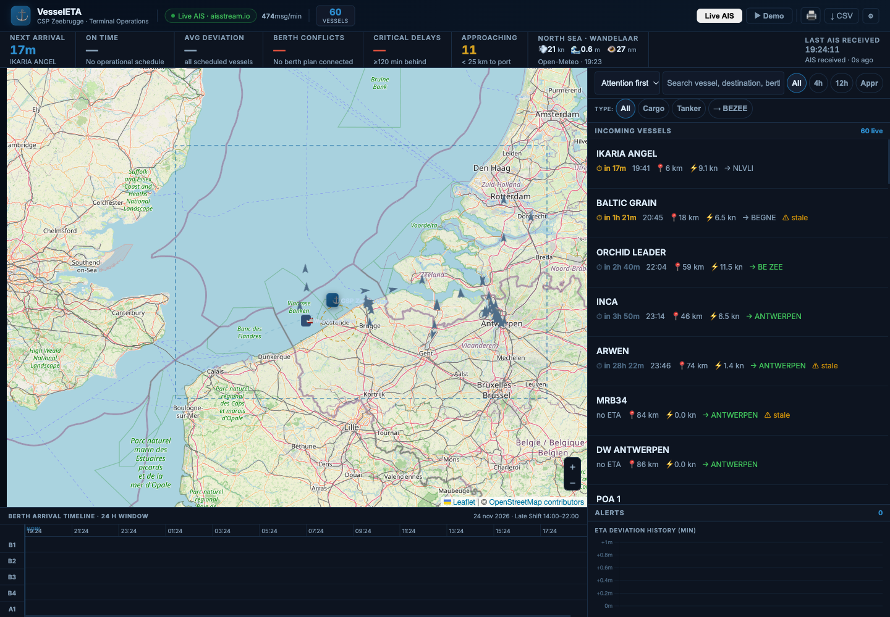
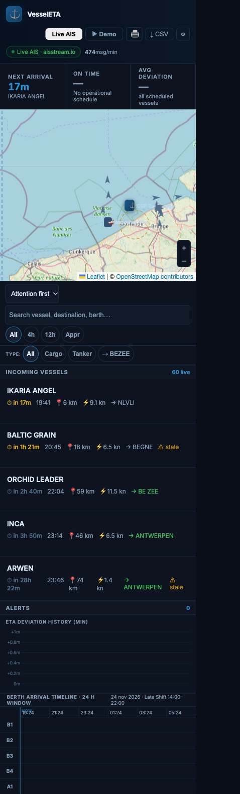

# VesselETA — Zeebrugge approach monitor

[](https://github.com/phlppgdfry/vessel-eta-tracker/actions/workflows/portfolio-pages.yml)

**[Open live AIS](https://phlppgdfry.github.io/vessel-eta-tracker/)** · **[Open simulation](https://phlppgdfry.github.io/vessel-eta-tracker/?mode=demo)** · [Walkthrough](docs/PORTFOLIO.md) · [Verification](docs/VERIFICATION.md)

Live positions around Zeebrugge arrive through a server-side AISStream relay.
Visitors need no key. The optional simulation demonstrates arrival deviations,
berth conflicts and handover planning with eight clearly labelled sample vessels.
This is an independent portfolio project, not an endorsed CSP system.



<details><summary>Mobile live preview</summary>

</details>

## Operational purpose

A delayed vessel affects crane allocation, yard preparation and truck appointments.
VesselETA brings position, speed and distance into one searchable map and vessel list.
The simulation shows how planners could compare estimated arrivals with an operational
schedule. **No production N4 schedule or berth plan is connected.**

| Capability | Live AIS | Simulation |
|---|---|---|
| Position, course and speed | AISStream reports | Generated scenario |
| Destination and vessel type | When broadcast by the vessel | Sample data |
| Estimated arrival | Straight-line distance / reported speed | Same calculation |
| Scheduled arrival, voyage and berth | Unavailable | Synthetic examples |
| Deviation and berth-conflict alerts | Unavailable without an operational plan | Interactive scenario |
| Search, vessel details, CSV and printable report | Available, with source labels | Available, with source labels |

ETA is an illustrative distance/speed estimate, not a confirmed port call. It does
not model fairways, pilotage, tides, stops or actual berth readiness. A vessel in
the monitored area is not necessarily heading to Zeebrugge.

## Data flow

```text
AISStream → Vercel server (private key, fixed monitoring area)
                    ↓ validated public vessel fields only
             GitHub Pages / Vercel dashboard
```

The public relay is read-only. It shares an upstream subscription between visitors
on the same warm instance, limits payloads and clients, and closes sessions before
the function duration limit. The browser reconnects with backoff. An outage stays
visible; the site never silently replaces live positions with sample vessels.
The short-lived in-memory cache is not a vessel-history database or a global
connection coordinator. This setup targets portfolio traffic; AISStream account
connection limits still apply across separately scaled instances.

## Run locally

Use Node 24:

```sh
npm ci
npm start
```

Open `http://localhost:3000/?mode=demo` for the simulation. A personal live key can
be entered in Settings on localhost; it is held in session storage and sent only
to the local `/ais` proxy. The public website disables this key field and uses
the server-owned relay instead.

The public relay accepts the two deployed website origins. For local development
of the relay, pass an explicit local origin to `createPublicServer`; never expose
the local personal-key proxy as a public service.

## Deploy the public relay

The linked Vercel project is `kippiegs-projects/vessel-eta-live`.
Store `AISSTREAM_API_KEY` as a **Secret, Production** environment variable in that
project, then deploy with `vercel --prod`. Never put the value in source, command
arguments, a `NEXT_PUBLIC_` variable, a browser bundle or GitHub Pages.

- Frontend and relay: [vessel-eta-live.vercel.app](https://vessel-eta-live.vercel.app/)
- Public status: [/api/live](https://vessel-eta-live.vercel.app/api/live) (configuration status, no secret)
- GitHub Pages publishes only the explicit `site/` build artifact.
- Vercel deploys the same frontend and the `api/live.mjs` Node function in Paris.
- Both sites connect to `wss://vessel-eta-live.vercel.app/api/live`.

After a key rotation, redeploy and run `node scripts/check-live.cjs`; this probes
the public endpoint without reading the key. The previously exposed credential
was disabled in the provider account on 24 November 2026.

## Verification

```sh
npm test
npm run test:e2e
node --test .github/scripts/deploy-pages.test.mjs
npm audit
```

Tests cover the relay subscription, sanitization, origin rejection, shared
connection, read-only clients, provider errors and session expiry. Desktop and
mobile browser tests cover simulation, live-mode separation, failure states,
settings, filtering, exports and safe printing. CI runs these before Pages deploys.

Leaflet and Chart.js come from locked npm dependencies. Map tiles use attributed
OpenStreetMap and optional weather uses Open-Meteo. Weather or tile failures do
not convert simulated positions into live data.
